# UAV-DDT-HeritageBench

[](https://creativecommons.org/licenses/by/4.0/)
[](https://doi.org/10.5281/zenodo.21429615)

Manuscript, benchmark code, and dataset for:

> **UAV-Based Neural Reconstruction of Dong Drum Towers: A Multi-Case Benchmark for Conservation-Oriented Method Selection**
> Tao Jiaxing — *IEEE Transactions on Visualization and Computer Graphics*, 2026

<p align="center">
  
  <br>
  <em>UAV-based neural reconstruction of Dong Drum Towers — novel-view synthesis across four heritage scenes and four methods.</em>
</p>

This repository provides the **manuscript, benchmark code, and dataset** for a study evaluating UAV-based neural 3D reconstruction methods applied to Dong minority Drum Tower heritage sites in China. Four neural methods (NeRF, 2DGS, 3DGS, Instant-NGP) plus a conventional SfM-MVS baseline are compared under a unified, fairness-controlled protocol — covering novel-view rendering quality, geometric consistency, dark-region wooden-structure preservation, and ground-level (upward-facing) reconstruction — with results interpreted for conservation-oriented method selection.

## Overview

**Methods benchmarked (4 + 1 baseline)**: NeRF, 2DGS, 3DGS, and Instant-NGP (INGP), plus a conventional COLMAP SfM-MVS photogrammetric baseline. 2DGS and 3DGS share the same COLMAP workspace and Gaussian-splatting codebase.

**Pipeline (6 stages)**: UAV image acquisition → corpus construction → camera pose estimation & sparse reconstruction (COLMAP) → neural rendering/reconstruction (4 methods) → quantitative & qualitative evaluation (rendering, geometry, dark regions) → conservation-oriented interpretation.

**Evaluation dimensions**:

| Dimension                | Metrics                                   | Interpretation                                               |
| ------------------------ | ----------------------------------------- | ------------------------------------------------------------ |
| Novel-view rendering     | PSNR, SSIM, LPIPS                         | Pixel-level fidelity, structural consistency, perceptual quality |
| Training efficiency      | Training time                             | Computational cost on identical hardware                     |
| Real-time capability     | Rendering speed (FPS)                     | Interactive visualization for conservation workflows         |
| Geometric consistency    | Accuracy, Recall, F1, NCD, P95            | Agreement with the SfM-MVS photogrammetric reference         |
| Dark-region preservation | Dark/lit coverage ratio, dark-region PSNR | Completeness of wooden structures under eaves and corridors  |

**Fairness control**: identical UAV image set per scene, shared SfM camera poses, common LLFF-style train/test split (every 8th frame held out), same workstation (RTX 4090), and default/recommended parameters per method.

|     朝利 (Chaoli)      |     从江 (Congjiang)      |     则里 (Zeli)      |     增冲 (Zengchong)      |
| :--------------------: | :-----------------------: | :------------------: | :-----------------------: |
| 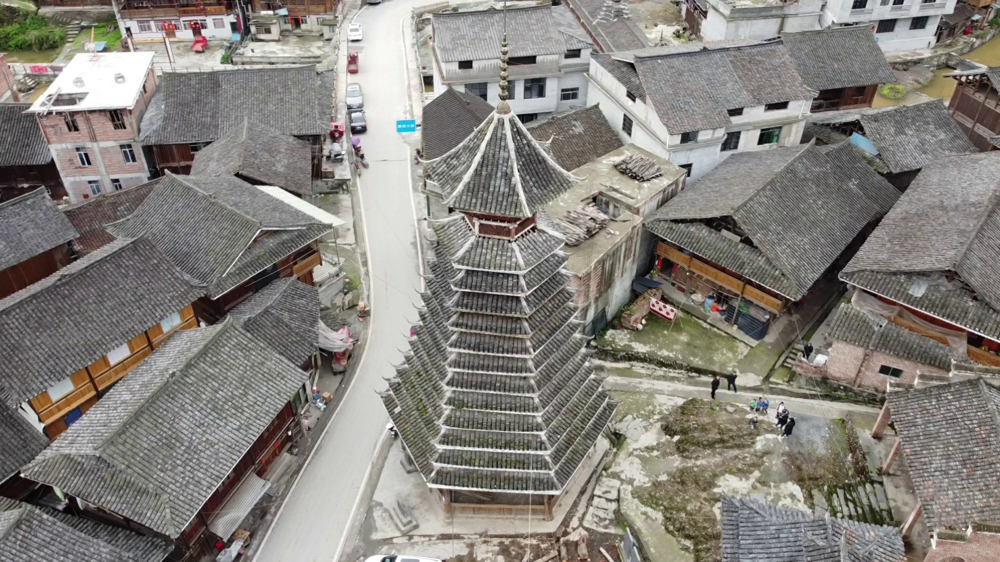 |  | 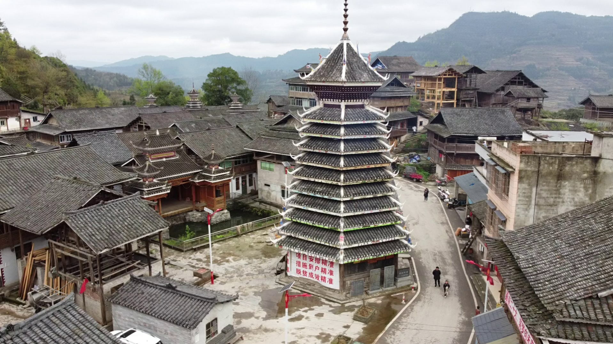 | 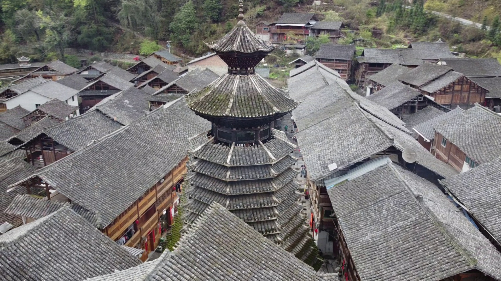 |

------

## New: Extended Benchmark Experiments

Four additional experiments extend the original rendering benchmark toward conservation-relevant evaluation. All comparisons use **identically cropped regions** (tower body, cropped in MeshLab) to guarantee a fair visual and geometric comparison.

### 1. Five-Method Point Cloud Comparison

Point clouds of all five methods — **SfM-MVS, 2DGS, 3DGS, NeRF (Sparse/Dense), INGP (Sparse/Dense)** — extracted for the same tower-body region of each of the four scenes:

<p align="center">
  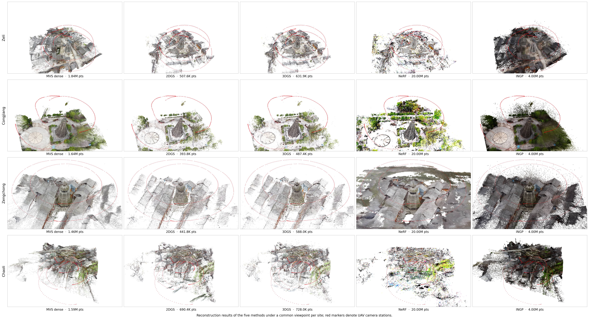
  <br>
  <em>Point cloud comparison across four Dong drum tower scenes and five reconstruction methods (tower body cropped at identical positions in MeshLab).</em>
</p>

### 2. Dark-Region Wooden Structure Analysis

Dong drum towers contain intricate wooden structures that are poorly illuminated in UAV imagery — beneath multi-tier eaves, at imitation-dougong / chuandou joints, and inside corridors. Because UAV capture is mostly downward-looking, these regions are nearly invisible to conventional MVS.

We use ground-level upward-facing imagery (Congjiang: 423 train / 61 test; Zengchong: 782 train / 112 test, 540×960) and evaluate how much of the **dark region** (bottom-25% luminance pixels, with a 2% depth-tolerance check against the Poisson-mesh front surface) each method reconstructs:

| Site      | Test views | Dark-lower ratio | Dark coverage | Lit coverage | Views dark < lit | 3DGS dark PSNR | INGP dark PSNR |
| --------- | ---------- | ---------------- | ------------- | ------------ | ---------------- | -------------- | -------------- |
| Congjiang | 61         | 73.3%            | 0.146         | 0.262        | 50 / 61          | **24.81 dB**   | 22.10 dB       |
| Zengchong | 112        | 90.1%            | 0.291         | 0.454        | 103 / 112        | **29.14 dB**   | 26.13 dB       |

MVS fused point clouds: Congjiang 2,015,973 points; Zengchong 5,603,776 points.

<p align="center">
  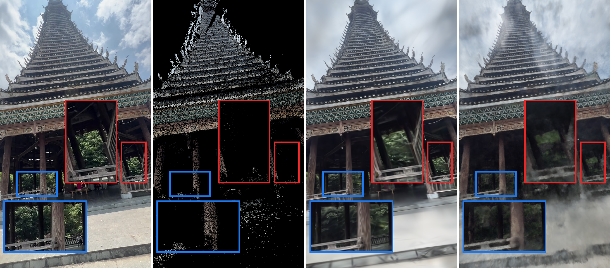
  <br>
  <em>Congjiang — ground-level test view. Left to right: ground truth, SfM-MVS (depth-consistent points only), 3DGS, INGP. MVS leaves large holes beneath the eaves and inside the corridor; 3DGS preserves the continuous wooden framework.</em>
</p>

<p align="center">
  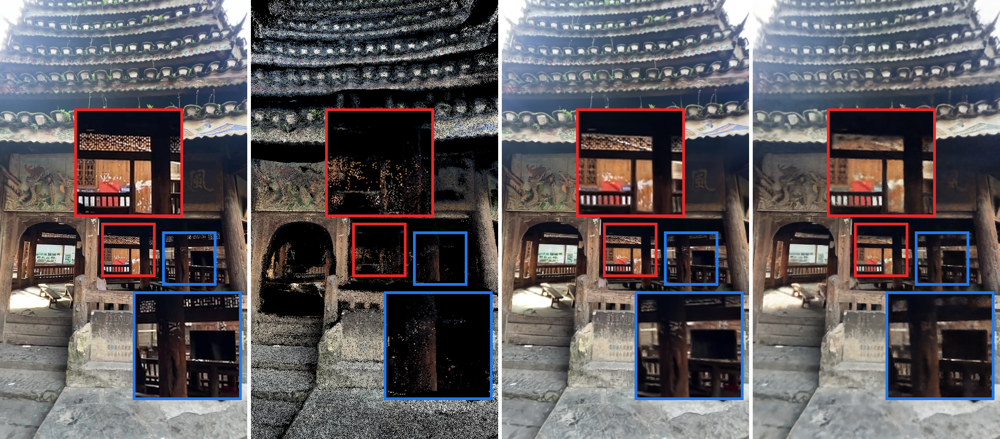
  <br>
  <em>Zengchong — ground-level test view, same layout. The dark-region coverage of MVS is consistently lower than the lit region, while 3DGS recovers the full contour of the wooden brackets.</em>
</p>

**Key findings**: (1) MVS dark-region coverage is systematically lower than lit-region coverage (Congjiang 0.146 vs 0.262; Zengchong 0.291 vs 0.454). (2) Without the depth-consistency check the conclusion reverses — floating points from the sky/ground would falsely fill dark areas. (3) 3DGS outperforms INGP by 2.7–3.0 dB dark-region PSNR.

### 3. Geometric Consistency Evaluation (SfM-MVS as Reference)

The conventional SfM-MVS reconstruction serves as the **photogrammetric reference** (not geometric ground truth). Neural reconstructions are registered to the MVS frame, cropped to the MVS extent, and voxel-downsampled at τ/2 before evaluation (τ = 0.001H, H = tower height).

**MVS baseline statistics** (train-only reconstruction, COLMAP 3.14, screened Poisson depth 13):

| Scene     | Train / Test | Dense points | Mesh vertices | Mesh faces | Processing time |
| --------- | ------------ | ------------ | ------------- | ---------- | --------------- |
| Chaoli    | 490 / 54     | 1,590,017    | 927,186       | 1,847,494  | 43.2 min        |
| Congjiang | 496 / 55     | 1,637,539    | 2,692,817     | 5,365,504  | 43.4 min        |
| Zeli      | 588 / 65     | 1,838,965    | 684,975       | 1,365,993  | 51.2 min        |
| Zengchong | 467 / 56     | 1,459,562    | 1,519,439     | 3,009,029  | 41.5 min        |

**Geometric consistency — tower body only** (uniformly cropped in MeshLab; unified COLMAP/SfM-MVS coordinate system; voxel downsampling at τ/2; threshold τ = 0.001H):

| Scene     | Method | Accuracy | Recall     | F1-score   | NCD        | P95    |
| --------- | ------ | -------- | ---------- | ---------- | ---------- | ------ |
| Zeli      | NeRF   | 0.0447   | 0.2205     | 0.0744     | 0.0232     | 0.8048 |
|           | 2DGS   | 0.0004   | 0.0000     | 0.0001     | 0.0913     | 0.9627 |
|           | 3DGS   | 0.0003   | 0.0001     | 0.0001     | 0.0596     | 0.4705 |
|           | INGP   | 0.0589   | 0.0839     | 0.0692     | 0.0080     | 0.3104 |
| Congjiang | NeRF   | 0.0310   | 0.2250     | 0.0545     | 0.0320     | 1.0197 |
|           | 2DGS   | 0.0878   | 0.0136     | 0.0236     | 0.0089     | 0.0354 |
|           | 3DGS   | 0.0910   | 0.0330     | 0.0485     | 0.0075     | 0.0429 |
|           | INGP   | 0.0786   | 0.1219     | 0.0956     | 0.0090     | 0.4016 |
| Zengchong | NeRF   | 0.0338   | 0.1953     | 0.0576     | 0.0089     | 0.3865 |
|           | 2DGS   | 0.0247   | 0.0044     | 0.0074     | 0.0084     | 0.0349 |
|           | 3DGS   | 0.0282   | 0.0156     | 0.0201     | 0.0077     | 0.0711 |
|           | INGP   | 0.0236   | 0.0468     | 0.0314     | 0.0084     | 0.3234 |
| Chaoli    | NeRF   | 0.0016   | 0.0099     | 0.0028     | 0.0755     | 0.6105 |
|           | 2DGS   | 0.0140   | 0.0026     | 0.0044     | 0.0046     | 0.0341 |
|           | 3DGS   | 0.0145   | 0.0084     | 0.0106     | 0.0044     | 0.0365 |
|           | INGP   | 0.0185   | 0.0302     | 0.0229     | 0.0043     | 0.0597 |
| **Mean**  | NeRF   | 0.0278   | 0.1627     | 0.0473     | 0.0349     | 0.7054 |
|           | 2DGS   | 0.0317   | 0.0052     | 0.0089     | 0.0283     | 0.2668 |
|           | 3DGS   | 0.0335   | 0.0143     | 0.0198     | 0.0198     | 0.1553 |
|           | INGP   | 0.0449   | **0.0707** | **0.0547** | **0.0075** | 0.2738 |

**Held-out view rendering — all five methods on the same test poses** (SfM-MVS rendered by ray-casting its Poisson mesh; LPIPS uses AlexNet):

| Scene     | Method  | PSNR ↑    | SSIM ↑     | LPIPS ↓    | Views  |
| --------- | ------- | --------- | ---------- | ---------- | ------ |
| Chaoli    | SfM-MVS | 14.11     | 0.4013     | 0.4892     | n = 54 |
|           | NeRF    | 18.10     | 0.3648     | 0.6056     |        |
|           | 2DGS    | 26.92     | 0.9227     | 0.0518     |        |
|           | 3DGS    | **30.29** | **0.9542** | **0.0300** |        |
|           | INGP    | 26.62     | 0.8754     | 0.1130     |        |
| Congjiang | SfM-MVS | 12.78     | 0.3415     | 0.4641     | n = 55 |
|           | NeRF    | 21.07     | 0.4834     | 0.4328     |        |
|           | 2DGS    | 32.02     | 0.9551     | 0.0296     |        |
|           | 3DGS    | **33.90** | **0.9691** | **0.0191** |        |
|           | INGP    | 29.83     | 0.9150     | 0.0706     |        |
| Zeli      | SfM-MVS | 14.71     | 0.3197     | 0.5454     | n = 65 |
|           | NeRF    | 18.66     | 0.4302     | 0.4941     |        |
|           | 2DGS    | 28.67     | 0.9510     | 0.0355     |        |
|           | 3DGS    | **30.79** | **0.9659** | **0.0230** |        |
|           | INGP    | 27.19     | 0.9101     | 0.0774     |        |
| Zengchong | SfM-MVS | 12.98     | 0.3565     | 0.4787     | n = 56 |
|           | NeRF    | 19.38     | 0.3737     | 0.5489     |        |
|           | 2DGS    | 29.52     | 0.9520     | 0.0286     |        |
|           | 3DGS    | **32.27** | **0.9693** | **0.0188** |        |
|           | INGP    | 28.05     | 0.9067     | 0.0702     |        |
| **Mean**  | SfM-MVS | 13.65     | 0.3548     | 0.4943     |        |
|           | NeRF    | 19.30     | 0.4130     | 0.5203     |        |
|           | 2DGS    | 29.28     | 0.9452     | 0.0364     |        |
|           | 3DGS    | **31.81** | **0.9646** | **0.0227** |        |
|           | INGP    | 27.92     | 0.9018     | 0.0828     |        |

Because both the MVS and neural reconstructions originate from the same UAV image observations, these distances indicate **cross-representation agreement with the conventional photogrammetric solution** rather than independently validated geometric accuracy. The geometric ranking does not necessarily match the PSNR/SSIM/LPIPS ranking — appearance fidelity and geometric consistency are related but distinct properties of a reconstructed heritage scene.

### 4. Ground-Level View Reconstruction Comparison

Ground-level (upward-facing) images of the four towers, reconstructed with the four neural methods and compared against the ground-truth photographs (two test-view groups per scene: full view + zoomed crop of conservation-relevant wooden details):

|               Chaoli               |               Congjiang               |
| :--------------------------------: | :-----------------------------------: |
| 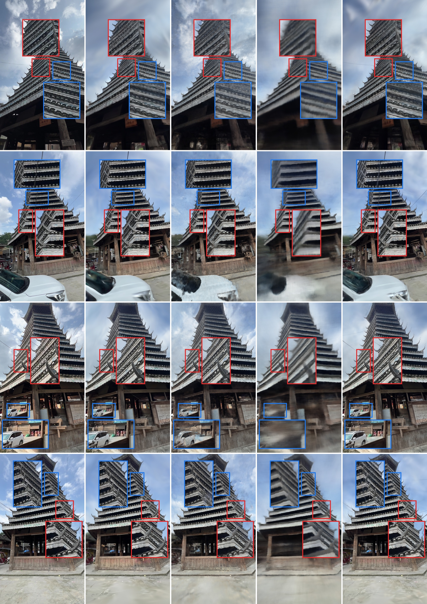 | 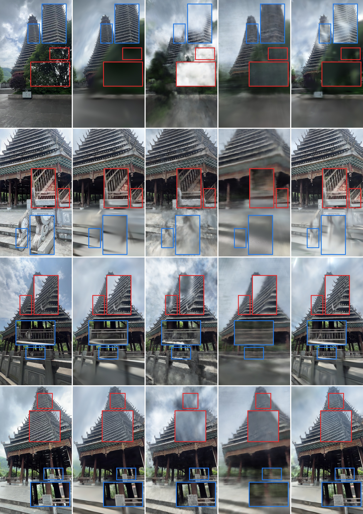 |
|              **Zeli**              |             **Zengchong**             |
|  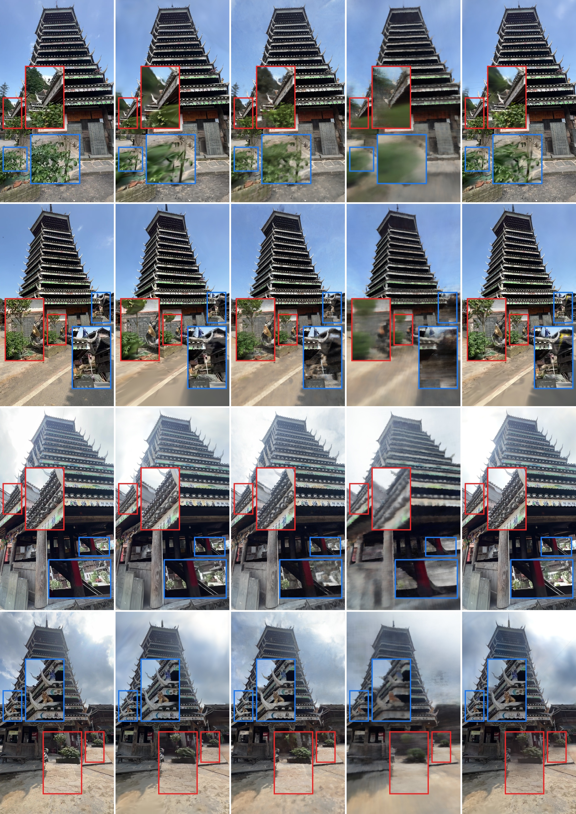  | 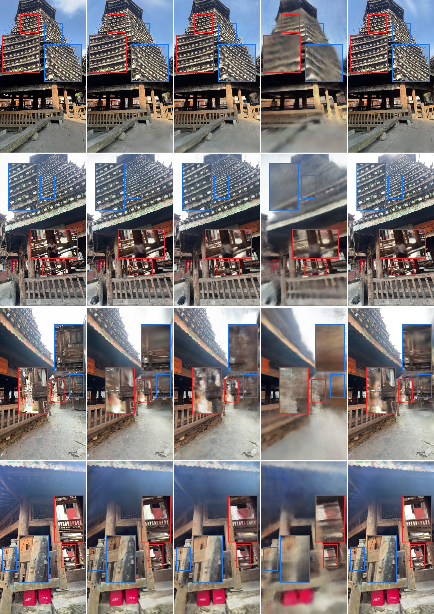 |

*Each composite: 5 columns (ground truth, 2DGS, INGP, NeRF, 3DGS) × 4 rows (two view groups, full view and zoomed crop).*

------

## Prerequisites

**To build the paper:**

- TeX Live 2021+ or MiKTeX (with `pdflatex`, `bibtex`)
- `make` (Linux/macOS) or a LaTeX IDE (Overleaf, TeXstudio) on Windows

**To run the benchmark:**

- CUDA-capable GPU (experiments used an NVIDIA RTX 4090, 24 GB)
- Python 3.8+, PyTorch (2DGS / 3DGS / NeRF-pytorch)
- COLMAP 3.14.0 with CUDA
- Method repos cloned locally (paths set in `code/scenes.sh`):
  `2d-gaussian-splatting`, `gaussian-splatting`, `nerf`, `instant-ngp`
- See `code/requirements.txt` for the Python environment

## Build the Paper

The LaTeX manuscript is at the repository root (`main.tex` + `sections/`):

```bash
make            # compile PDF (pdflatex + bibtex)
make clean      # remove auxiliary files
make cleanall   # remove all generated files including PDF
make view       # compile and open PDF (Windows / macOS / Linux)
```

Or manually:

```bash
pdflatex main
bibtex main
pdflatex main
pdflatex main
```

## Repository Structure

```
UAV-DDT-HeritageBench/
├── main.tex                # Main LaTeX entry file
├── sections/               # Per-section .tex files
│   ├── abstract.tex
│   ├── introduction.tex
│   ├── research_background.tex
│   ├── study_objects.tex
│   ├── method.tex
│   ├── analysis.tex
│   └── conclusion.tex
├── figures/media/          # All paper figures (image1.png … image14.png)
├── references.bib          # BibTeX references
├── IEEEtran.cls / .bst     # IEEE journal document class & style
├── Makefile                # Build automation
│
├── code/                   # Benchmark code
│   ├── scenes.sh           # Shared scene→dir mapping & repo paths
│   ├── preprocess/
│   │   └── extract_frames.py   # UAV video → frame_XXXXXX.jpg (+ blur screen)
│   ├── colmap/
│   │   └── run_sfm.sh      # SfM pose estimation (COLMAP 3.14.0, CUDA)
│   ├── methods/            # Per-method training wrappers
│   │   ├── nerf/train.sh   # bmild/nerf-pytorch (blender, factor 8)
│   │   ├── 2dgs/train.sh   # hbb1/2d-gaussian-splatting (30k, sh=3)
│   │   ├── 3dgs/train.sh   # graphdeco-inria/gaussian-splatting (30k)
│   │   └── ingp/train.sh   # Instant-NGP (50k steps, hash encoding)
│   ├── eval/
│   │   └── metrics.py      # PSNR / SSIM / LPIPS over test views
│   └── requirements.txt    # Python environment
│
├── data/                   # Dataset (see Data Availability)
│   ├── <scene>/images/     # UAV frames (frame_XXXXXX.jpg)
│   ├── <scene>/{2dgs,nerf,ingp}/  # Per-method COLMAP + transforms
│   └── splits/             # Test image lists per scene (LLFF hold=8)
│
├── supplementary/          # Reconstruction result videos (*.mp4)
├── assets/                 # README figures (scene thumbnails, comparisons)
├── CITATION.cff            # Citation metadata
├── .gitignore              # Ignores build artifacts & large data
├── LICENSE                 # CC-BY-4.0
└── README.md
```

## Reproducing the Benchmark

**Hardware/software used**: NVIDIA RTX 4090 (24 GB), COLMAP 3.14.0 (CUDA), PyTorch (2DGS/3DGS), TensorFlow 2.x (NeRF), Instant-NGP v2.0dev.

Scene keys: `zeli` · `chaoli` · `congjiang` · `zengchong` (or `all`).
Edit `code/scenes.sh` to point `DATA_ROOT` / `OUTPUT_ROOT` / repo paths at your machine.

```bash
# 1. Set up Python environment
cd code
pip install -r requirements.txt

# 2. (Optional) Extract frames from a UAV video
python preprocess/extract_frames.py --video zeli.mp4 --out ../data/则里/images

# 3. Camera pose estimation with COLMAP (shared by 2DGS & 3DGS)
bash colmap/run_sfm.sh zeli        # or: bash colmap/run_sfm.sh all

# 4. Train each method
bash methods/2dgs/train.sh zeli    # 30k iters, sh_degree 3
bash methods/3dgs/train.sh zeli    # 30k iters (reuses 2DGS COLMAP)
bash methods/nerf/train.sh  zeli   # blender type, factor 8
bash methods/ingp/train.sh  zeli   # 50k steps, hash encoding

# 5. Evaluate — PSNR / SSIM / LPIPS across all scenes & methods
python eval/metrics.py --scene all --method all
# Results saved to <OUTPUT_ROOT>/results_summary.csv
```

> **Note on 3DGS**: at repo assembly time only 2DGS / NeRF / INGP outputs existed on the training server. `methods/3dgs/train.sh` reproduces 3DGS from the same COLMAP inputs used by 2DGS — run it to complete the four-method benchmark.

## Qualitative Results

Novel-view renderings on **则里 (Zeli)**, held-out test view:

|      Ground Truth       |           NeRF            |           2DGS            |           3DGS            |           INGP            |
| :---------------------: | :-----------------------: | :-----------------------: | :-----------------------: | :-----------------------: |
|  | 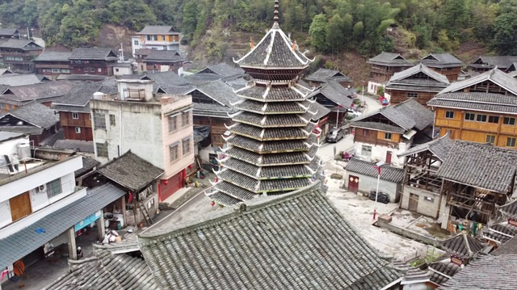 | 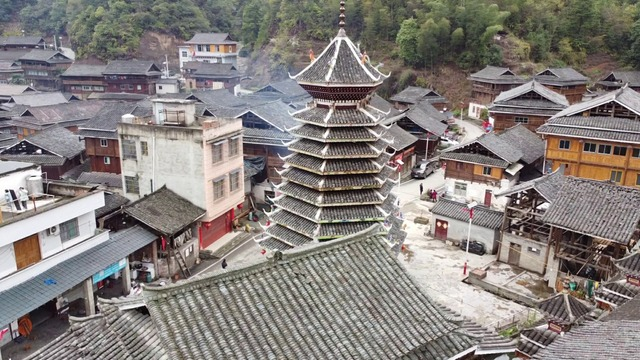 | 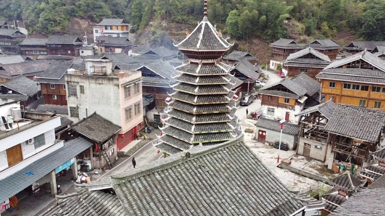 | 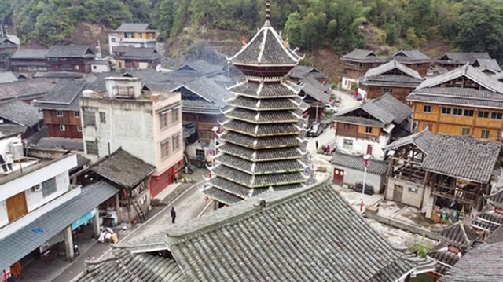 |

Renderings are exported from `<OUTPUT_ROOT>/<scene>/<method>/test/ours_*/renders/`. See the paper for full quantitative comparisons across all four scenes.

## Data Availability

The UAV image corpus, COLMAP sparse reconstructions, and train/test splits are archived on Zenodo (see [Citation](#citation)). Download and extract into `data/` following the structure above. Large binaries (raw images, checkpoints) are excluded from git via `.gitignore`.

## Related Repositories

| Resource                                                  | Description                                               |
| --------------------------------------------------------- | --------------------------------------------------------- |
| [3DGS-Survey](https://github.com/autumn119/3DGS-Survey)   | Project page (GitHub Pages)                               |
| [Zenodo archive](https://doi.org/10.5281/zenodo.21429615) | UAV image corpus & COLMAP reconstructions (permanent DOI) |

## Citation

If you use this work, please cite:

```bibtex
@article{tao2026_dong_drum_tower,
  author  = {Tao, Jiaxing},
  title   = {UAV-Based Neural Reconstruction of Dong Drum Towers: A Multi-Case Benchmark for Conservation-Oriented Method Selection},
  journal = {IEEE Transactions on Visualization and Computer Graphics},
  year    = {2026}
}
```

The archived dataset can be cited as:

```bibtex
@dataset{tao2026_dong_drum_tower_dataset,
  author    = {Tao, Jiaxing},
  title     = {UAV-DDT-HeritageBench: UAV Imagery and COLMAP Reconstructions of Dong Drum Towers},
  year      = {2026},
  publisher = {Zenodo},
  doi       = {10.5281/zenodo.21429615},
  url       = {https://doi.org/10.5281/zenodo.21429615}
}
```

## License

This work is licensed under **CC-BY-4.0**. See [LICENSE](LICENSE) for details.
