# UAV-DDT-HeritageBench


[](https://creativecommons.org/licenses/by/4.0/)

[](https://doi.org/10.5281/zenodo.21429615)


Benchmark code, dataset documentation, and supplementary materials for:


> **UAV-Based Neural Reconstruction of Dong Drum Towers: A Multi-Case Benchmark for Conservation-Oriented Method Selection**

> Tao JiaXing — 2026 · *Manuscript under review* (LaTeX source not included in this repository)


<p align="center">

  

  <br>

  <em>UAV-based neural reconstruction of Dong Drum Towers — novel-view synthesis across four heritage scenes and four methods.</em>

</p>


This repository provides the **benchmark code, dataset documentation, and supplementary materials** for a study evaluating UAV-based neural 3D reconstruction methods applied to Dong minority Drum Tower heritage sites in China. Results are reported on **two independently captured image corpora** — a UAV aerial corpus (479\u00d7269, orbit capture) and a ground-level handheld-video corpus (540\u00d7960, portrait) — so that method ranking can be checked against the capture geometry actually available at a heritage site. Four neural methods (NeRF, 2DGS, 3DGS, Instant-NGP) plus a conventional SfM-MVS baseline are compared under a unified, fairness-controlled protocol — covering novel-view rendering quality, geometric consistency, dark-region wooden-structure preservation, and ground-level (upward-facing) reconstruction — with results interpreted for conservation-oriented method selection.


## Overview


**Methods benchmarked (4 + 1 baseline)**: NeRF, 2DGS, 3DGS, and Instant-NGP (INGP), plus a conventional COLMAP SfM-MVS photogrammetric baseline. 2DGS and 3DGS share the same COLMAP workspace and Gaussian-splatting codebase.


**Pipeline (6 stages)**: UAV image acquisition → corpus construction → camera pose estimation & sparse reconstruction (COLMAP) → neural rendering/reconstruction (4 methods) → quantitative & qualitative evaluation (rendering, geometry, dark regions) → conservation-oriented interpretation.


**Evaluation dimensions**:


| Dimension | Metrics | Interpretation |

|-----------|---------|----------------|

| Novel-view rendering | PSNR, SSIM, LPIPS | Pixel-level fidelity, structural consistency, perceptual quality |

| Training efficiency | Training time | Computational cost on identical hardware |

| Real-time capability | Rendering speed (FPS) | Interactive visualization for conservation workflows |

| Geometric consistency | Accuracy, Recall, F1, NCD, P95 | Agreement with the SfM-MVS photogrammetric reference |

| Dark-region preservation | Dark/lit coverage ratio, dark-region PSNR | Completeness of wooden structures under eaves and corridors |


**Fairness control (UAV aerial corpus)**: identical image set per scene, one shared SfM (COLMAP) pose solution used by all four methods, a fixed train/test split with ~10% of frames held out, identical resolution and colour handling, a single shared metric implementation (PSNR/SSIM via `skimage`, LPIPS via AlexNet), and one workstation — an NVIDIA **RTX 4090 D (24 GB)**, one process at a time. Each method uses its official implementation with default hyperparameters (NeRF 200k iters, 2DGS/3DGS 30k iters, INGP 50k steps).

**Fairness control (ground-level corpus)**: handheld video sampled at 2 fps (Congjiang additionally 1-in-4, ~0.5 fps) and downsampled to 540×960; only SfM-registered frames are kept; every 8th frame (sorted by filename) is held out for testing. Camera poses, test frames, resolution and metric code are again shared by all four methods on the same RTX 4090 D workstation. Because test frames sit ~0.5 s from their neighbouring training frames, ground-level scores reflect *interpolation* quality and are **not** directly comparable in absolute value to the aerial scores.


| Chaoli | Congjiang | Zeli | Zengchong |

|:---:|:---:|:---:|:---:|

| 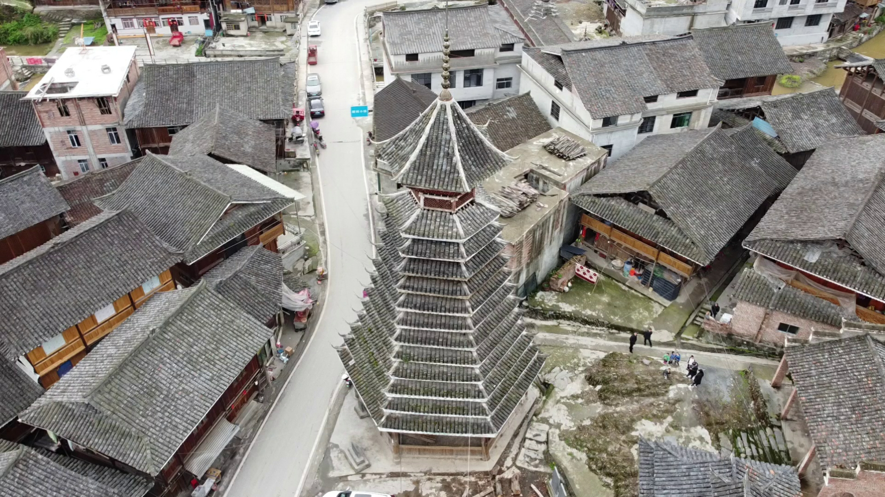 |  | 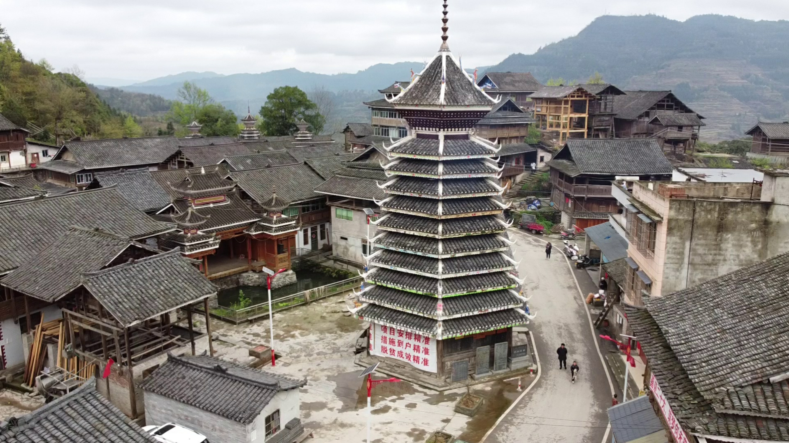 | 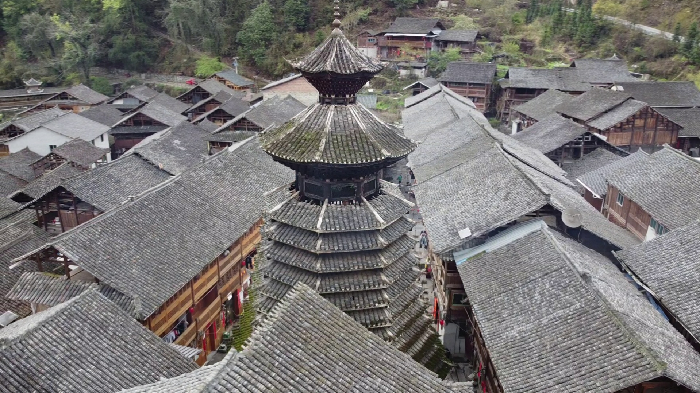 |


------


## Main Results (UAV Aerial Corpus)

All numbers below are four-scene averages measured on the held-out test frames unless a per-scene column is given. Best value per column in **bold**.

### Dataset statistics

| Scene     | Images | Resolution | Capture   | Train | Test |
| :-------- | -----: | :--------- | :-------- | ----: | ---: |
| Chaoli    |    544 | 478×269    | UAV orbit |   490 |   54 |
| Congjiang |    551 | 479×269    | UAV orbit |   496 |   55 |
| Zeli      |    653 | 479×269    | UAV orbit |   588 |   65 |
| Zengchong |    523 | 479×269    | UAV orbit |   467 |   56 |

Raw frames are ~1914–1918 × 1076–1078; training and evaluation both use the 1/4-downsampled resolution shown above. The split is fixed and identical for all four methods. Zengchong was captured at 914 frames, of which the 523 frames sharing a consistent pose solution are used.

### Novel-view quality

**PSNR (dB, ↑)**

| Method |    Chaoli |      Zeli | Congjiang | Zengchong |      Mean |
| :----- | --------: | --------: | --------: | --------: | --------: |
| NeRF   |     16.56 |     19.26 |     20.60 |     21.84 |     19.57 |
| 2DGS   |     26.97 |     28.66 |     32.06 |     29.55 |     29.31 |
| 3DGS   | **30.22** | **30.70** | **33.87** | **32.36** | **31.79** |
| INGP   |     26.58 |     27.12 |     29.38 |     28.14 |     27.81 |

**SSIM (↑)**

| Method |    Chaoli |      Zeli | Congjiang | Zengchong |      Mean |
| :----- | --------: | --------: | --------: | --------: | --------: |
| NeRF   |     0.243 |     0.511 |     0.460 |     0.561 |     0.444 |
| 2DGS   |     0.923 |     0.950 |     0.955 |     0.953 |     0.945 |
| 3DGS   | **0.955** | **0.965** | **0.969** | **0.970** | **0.965** |
| INGP   |     0.879 |     0.913 |     0.898 |     0.914 |     0.901 |

**LPIPS (↓)**

| Method |    Chaoli |      Zeli | Congjiang | Zengchong |      Mean |
| :----- | --------: | --------: | --------: | --------: | --------: |
| NeRF   |     0.787 |     0.455 |     0.563 |     0.388 |     0.548 |
| 2DGS   |     0.053 |     0.036 |     0.030 |     0.028 |     0.037 |
| 3DGS   | **0.029** | **0.024** | **0.019** | **0.019** | **0.023** |
| INGP   |     0.102 |     0.071 |     0.083 |     0.063 |     0.080 |

3DGS ranks first on all three metrics in every scene, ahead of 2DGS by 2.48 dB PSNR on average. 2DGS is second on all three; INGP third (PSNR 27.81 dB, 3.98 dB below 3DGS) despite the shortest training time. NeRF is last on all three (19.57 dB) and is the only method that cannot render interactively.

### Training efficiency and resource consumption

| Method | Training time        | Peak GPU memory | Render speed  | Real-time |
| :----- | :------------------- | :-------------- | :------------ | :-------- |
| NeRF   | 11,138 s (≈3.1 h)    | 11.93 GiB       | 0.38 FPS      | No        |
| 2DGS   | 389 s (≈6.5 min)     | 1.91 GiB        | **241.0 FPS** | Yes       |
| 3DGS   | 510 s (≈8.5 min)     | 4.57 GiB        | 208.5 FPS     | Yes       |
| INGP   | **288 s (≈4.8 min)** | **1.78 GiB**    | 84.8 FPS      | Yes       |

Training time counts the training loop only (no data loading or checkpoint saving). Peak memory is the maximum of `nvidia-smi` sampled every 100 ms (includes the CUDA context). FPS is measured on an RTX 4090 D at native test resolution (479×269, INGP at 8 spp); ≥30 FPS counts as real-time. 3DGS averages ~1.36 M Gaussians per scene versus ~0.64 M for 2DGS, which explains both its higher memory and its slightly lower FPS.

### Equal wall-clock time budget

Iterations are not comparable across methods (INGP runs ~173.5 steps/s, 2DGS ~77.2 it/s, 3DGS ~58.8 it/s, NeRF ~18.0 it/s), so the four methods were also compared at identical elapsed training time. Snapshots are taken when the training clock first reaches the budget; a method that has already finished its default schedule keeps its final model (marked *done*).

| Budget         |   NeRF |       3DGS |   2DGS |   INGP | Best PSNR |
| :------------- | -----: | ---------: | -----: | -----: | :-------- |
| 30 s           | 15.222 | **25.808** | 25.123 | 25.806 | 3DGS      |
| 60 s           |  15.65 |  **26.95** |  26.44 |  26.61 | 3DGS      |
| 120 s          |  16.26 |  **29.52** |  26.99 |  27.37 | 3DGS      |
| 180 s          |  16.59 |  **30.09** |  27.84 |  27.66 | 3DGS      |
| 300 s          |  16.96 |  **31.03** |  29.02 |  27.81 | 3DGS      |
| 600 s (*done*) |  17.52 |  **31.79** |  29.31 |  27.81 | 3DGS      |

Values are four-scene mean PSNR (dB). From 600 s onward 2DGS/3DGS/INGP have finished and only NeRF keeps improving; it needs 10,800 s (193,931 iters) to reach its final 19.57 dB.

**Ranking stability** (Kendall τ against the default-configuration ranking 3DGS > 2DGS > INGP > NeRF):

| Budget           | PSNR ranking              |  τ   |
| :--------------- | :------------------------ | :--: |
| 30 s             | 3DGS > INGP > 2DGS > NeRF | 0.67 |
| 60 s             | 3DGS > INGP > 2DGS > NeRF | 0.67 |
| 120 s            | 3DGS > INGP > 2DGS > NeRF | 0.67 |
| 180 s – 10,800 s | 3DGS > 2DGS > INGP > NeRF | 1.00 |

The ranking only differs from the default configuration below 180 s, where INGP temporarily leads 2DGS by 0.17–0.68 dB. Two mechanisms drive this: INGP converges early (30 s already gives 25.81 dB, only 2.00 dB below its final value, while 3DGS still has 5.98 dB to gain), and 2DGS/3DGS periodically reset all Gaussian opacities to near zero every 3,000 iterations during densification, so a snapshot landing just after a reset reads artificially low. SSIM ranking is identical to the default configuration at every budget; LPIPS differs only at 60 s. Each method was trained once per scene, so sub-1 dB differences at early checkpoints should not be read as stable rankings.

------

## New: Extended Benchmark Experiments


Four additional experiments extend the original rendering benchmark toward conservation-relevant evaluation. All comparisons use **identically cropped regions** (tower body, cropped in MeshLab) to guarantee a fair visual and geometric comparison.


### 1. Five-Method Point Cloud Comparison


Point clouds of all five methods — **SfM-MVS, 2DGS, 3DGS, NeRF (Sparse/Dense), INGP (Sparse/Dense)** — extracted for the same tower-body region of each of the four scenes:


<p align="center">

  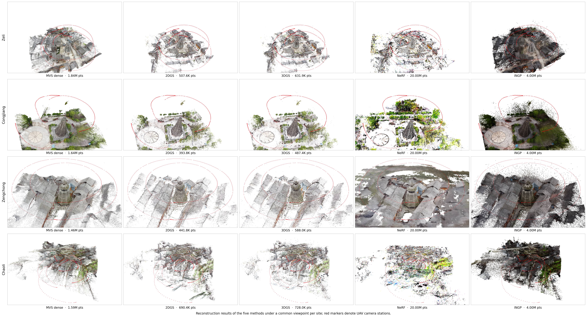

  <br>

  <em>Point cloud comparison across four Dong drum tower scenes and five reconstruction methods (tower body cropped at identical positions in MeshLab).</em>

</p>


### 2. Dark-Region Wooden Structure Analysis


Dong drum towers contain intricate wooden structures that are poorly illuminated in UAV imagery — beneath multi-tier eaves, at imitation-dougong / chuandou joints, and inside corridors. Because UAV capture is mostly downward-looking, these regions are nearly invisible to conventional MVS.


We use ground-level upward-facing imagery (Congjiang: 423 train / 61 test; Zengchong: 782 train / 112 test, 540×960) and evaluate how much of the **dark region** (bottom-25% luminance pixels, with a 2% depth-tolerance check against the Poisson-mesh front surface) each method reconstructs:


| Site | Test views | Dark-lower ratio | Dark coverage | Lit coverage | Views dark < lit | 3DGS dark PSNR | INGP dark PSNR |

|------|-----------|------------------|---------------|--------------|------------------|----------------|----------------|

| Congjiang | 61 | 73.3% | 0.146 | 0.262 | 50 / 61 | **24.81 dB** | 22.10 dB |

| Zengchong | 112 | 90.1% | 0.291 | 0.454 | 103 / 112 | **29.14 dB** | 26.13 dB |


MVS fused point clouds: Congjiang 2,015,973 points; Zengchong 5,603,776 points.


<p align="center">

  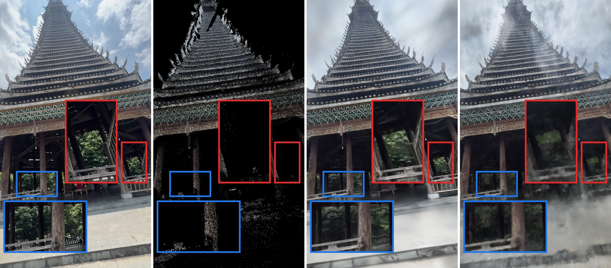

  <br>

  <em>Congjiang — ground-level test view. Left to right: ground truth, SfM-MVS (depth-consistent points only), 3DGS, INGP. MVS leaves large holes beneath the eaves and inside the corridor; 3DGS preserves the continuous wooden framework.</em>

</p>


<p align="center">

  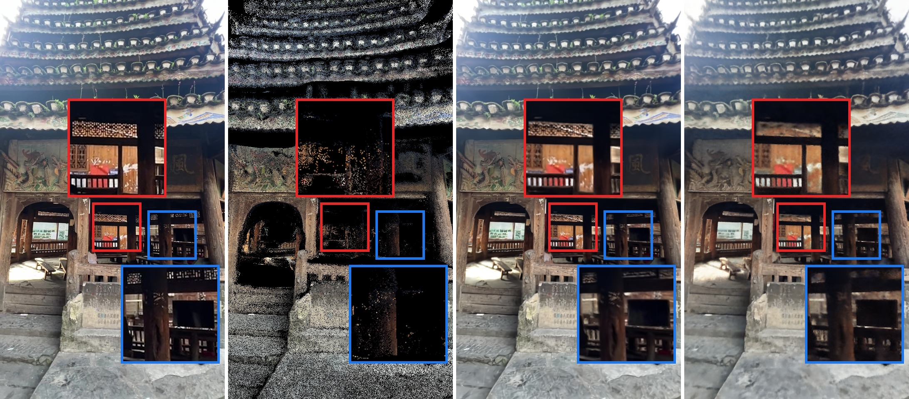

  <br>

  <em>Zengchong — ground-level test view, same layout. The dark-region coverage of MVS is consistently lower than the lit region, while 3DGS recovers the full contour of the wooden brackets.</em>

</p>


**Key findings**: (1) MVS dark-region coverage is systematically lower than lit-region coverage (Congjiang 0.146 vs 0.262; Zengchong 0.291 vs 0.454). (2) Without the depth-consistency check the conclusion reverses — floating points from the sky/ground would falsely fill dark areas. (3) 3DGS outperforms INGP by 2.7–3.0 dB dark-region PSNR.


### 3. Geometric Consistency Evaluation (SfM-MVS as Reference)


The conventional SfM-MVS reconstruction serves as the **photogrammetric reference** (not geometric ground truth). Neural reconstructions are registered to the MVS frame, cropped to the MVS extent, and voxel-downsampled at τ/2 before evaluation (τ = 0.001H, H = tower height).


**MVS baseline statistics** (train-only reconstruction, COLMAP 3.14, screened Poisson depth 13):


| Scene | Train / Test | Dense points | Mesh vertices | Mesh faces | Processing time |

|-------|-------------|--------------|---------------|-----------|-----------------|

| Chaoli | 490 / 54 | 1,590,017 | 927,186 | 1,847,494 | 43.2 min |

| Congjiang | 496 / 55 | 1,637,539 | 2,692,817 | 5,365,504 | 43.4 min |

| Zeli | 588 / 65 | 1,838,965 | 684,975 | 1,365,993 | 51.2 min |

| Zengchong | 467 / 56 | 1,459,562 | 1,519,439 | 3,009,029 | 41.5 min |


**Geometric consistency — tower body only** (uniformly cropped in MeshLab; unified COLMAP/SfM-MVS coordinate system; voxel downsampling at τ/2; threshold τ = 0.001H):


| Scene | Method | Accuracy | Recall | F1-score | NCD | P95 |

|-------|--------|----------|--------|----------|-----|-----|

| Chaoli | NeRF | 0.0016 | 0.0099 | 0.0028 | 0.0755 | 0.6105 |

| | 2DGS | 0.0140 | 0.0026 | 0.0044 | 0.0046 | 0.0341 |

| | 3DGS | 0.0145 | 0.0084 | 0.0106 | 0.0044 | 0.0365 |

| | INGP | 0.0185 | 0.0302 | 0.0229 | 0.0043 | 0.0597 |

| Congjiang | NeRF | 0.0310 | 0.2250 | 0.0545 | 0.0320 | 1.0197 |

| | 2DGS | 0.0878 | 0.0136 | 0.0236 | 0.0089 | 0.0354 |

| | 3DGS | 0.0910 | 0.0330 | 0.0485 | 0.0075 | 0.0429 |

| | INGP | 0.0786 | 0.1219 | 0.0956 | 0.0090 | 0.4016 |

| Zeli | NeRF | 0.0447 | 0.2205 | 0.0744 | 0.0232 | 0.8048 |

| | 2DGS | 0.0004 | 0.0000 | 0.0001 | 0.0913 | 0.9627 |

| | 3DGS | 0.0003 | 0.0001 | 0.0001 | 0.0596 | 0.4705 |

| | INGP | 0.0589 | 0.0839 | 0.0692 | 0.0080 | 0.3104 |

| Zengchong | NeRF | 0.0338 | 0.1953 | 0.0576 | 0.0089 | 0.3865 |

| | 2DGS | 0.0247 | 0.0044 | 0.0074 | 0.0084 | 0.0349 |

| | 3DGS | 0.0282 | 0.0156 | 0.0201 | 0.0077 | 0.0711 |

| | INGP | 0.0236 | 0.0468 | 0.0314 | 0.0084 | 0.3234 |

| **Mean** | NeRF | 0.0278 | 0.1627 | 0.0473 | 0.0349 | 0.7054 |

| | 2DGS | 0.0317 | 0.0052 | 0.0089 | 0.0283 | 0.2668 |

| | 3DGS | 0.0335 | 0.0143 | 0.0198 | 0.0198 | 0.1553 |

| | INGP | 0.0449 | **0.0707** | **0.0547** | **0.0075** | 0.2738 |


**Held-out view rendering — all five methods on the same test poses** (SfM-MVS rendered by ray-casting its Poisson mesh; LPIPS uses AlexNet):


| Scene | Method | PSNR ↑ | SSIM ↑ | LPIPS ↓ | Views |

|-------|--------|--------|--------|---------|-------|

| Chaoli | SfM-MVS | 14.11 | 0.4013 | 0.4892 | n = 54 |

| | NeRF | 18.10 | 0.3648 | 0.6056 | |

| | 2DGS | 26.92 | 0.9227 | 0.0518 | |

| | 3DGS | **30.29** | **0.9542** | **0.0300** | |

| | INGP | 26.62 | 0.8754 | 0.1130 | |

| Congjiang | SfM-MVS | 12.78 | 0.3415 | 0.4641 | n = 55 |

| | NeRF | 21.07 | 0.4834 | 0.4328 | |

| | 2DGS | 32.02 | 0.9551 | 0.0296 | |

| | 3DGS | **33.90** | **0.9691** | **0.0191** | |

| | INGP | 29.83 | 0.9150 | 0.0706 | |

| Zeli | SfM-MVS | 14.71 | 0.3197 | 0.5454 | n = 65 |

| | NeRF | 18.66 | 0.4302 | 0.4941 | |

| | 2DGS | 28.67 | 0.9510 | 0.0355 | |

| | 3DGS | **30.79** | **0.9659** | **0.0230** | |

| | INGP | 27.19 | 0.9101 | 0.0774 | |

| Zengchong | SfM-MVS | 12.98 | 0.3565 | 0.4787 | n = 56 |

| | NeRF | 19.38 | 0.3737 | 0.5489 | |

| | 2DGS | 29.52 | 0.9520 | 0.0286 | |

| | 3DGS | **32.27** | **0.9693** | **0.0188** | |

| | INGP | 28.05 | 0.9067 | 0.0702 | |

| **Mean** | SfM-MVS | 13.65 | 0.3548 | 0.4943 | |

| | NeRF | 19.30 | 0.4130 | 0.5203 | |

| | 2DGS | 29.28 | 0.9452 | 0.0364 | |

| | 3DGS | **31.81** | **0.9646** | **0.0227** | |

| | INGP | 27.92 | 0.9018 | 0.0828 | |


Because both the MVS and neural reconstructions originate from the same UAV image observations, these distances indicate **cross-representation agreement with the conventional photogrammetric solution** rather than independently validated geometric accuracy. The geometric ranking does not necessarily match the PSNR/SSIM/LPIPS ranking — appearance fidelity and geometric consistency are related but distinct properties of a reconstructed heritage scene.


### 4. Ground-Level View Reconstruction Comparison


Ground-level (upward-facing) images of the four towers, reconstructed with the four neural methods and compared against the ground-truth photographs (two test-view groups per scene: full view + zoomed crop of conservation-relevant wooden details):


| Chaoli | Congjiang |

|:---:|:---:|

| 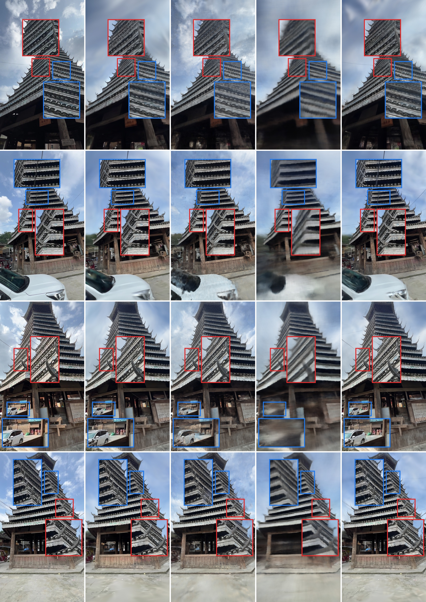 | 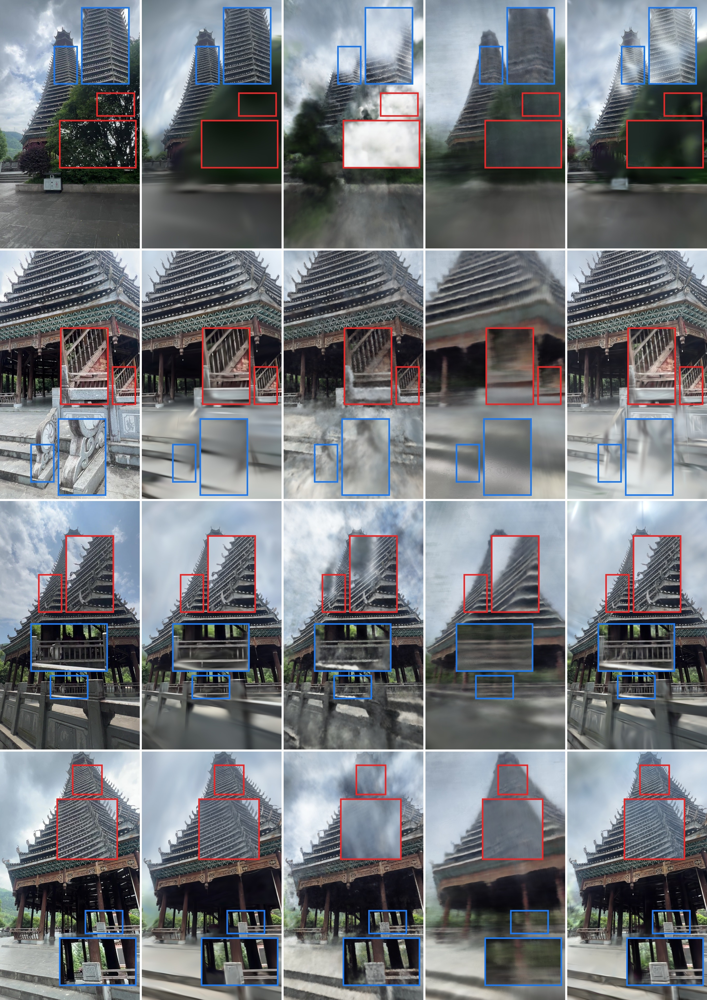 |

| **Zeli** | **Zengchong** |

| 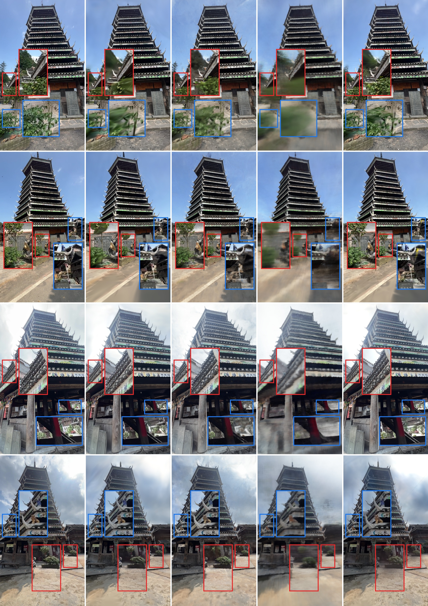 | 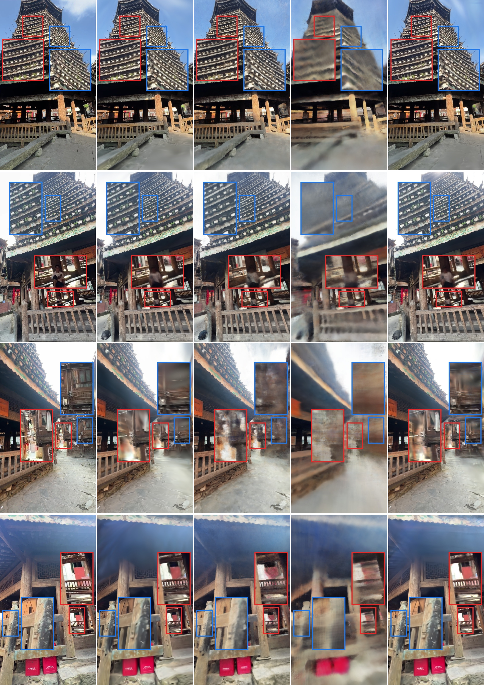 |


*Each composite: 5 columns (ground truth, 2DGS, INGP, NeRF, 3DGS) × 4 rows (two view groups, full view and zoomed crop).*

#### Ground-level quantitative results

The same four scenes were re-captured as handheld ground-level video and reconstructed with the identical protocol. Dataset statistics (frames are SfM-registered counts at 540×960):

| Scene     | Images | Train | Test |
| :-------- | -----: | ----: | ---: |
| Chaoli    |    509 |   445 |   64 |
| Congjiang |    484 |   423 |   61 |
| Zeli      |    401 |   350 |   51 |
| Zengchong |    894 |   782 |  112 |

| Method |    PSNR ↑ |    SSIM ↑ |   LPIPS ↓ | Training time        | Peak GPU memory | Render speed  |
| :----- | --------: | --------: | --------: | :------------------- | :-------------- | :------------ |
| NeRF   |     19.26 |     0.554 |     0.600 | 3,369 s (≈56.1 min)  | 3.70 GiB        | 0.10 FPS      |
| 2DGS   |     22.71 |     0.787 |     0.278 | 571 s (≈9.5 min)     | 2.75 GiB        | 226.4 FPS     |
| 3DGS   | **23.44** | **0.816** | **0.223** | 619 s (≈10.3 min)    | 2.81 GiB        | **248.0 FPS** |
| INGP   |     21.86 |     0.720 |     0.321 | **258 s (≈4.3 min)** | **2.50 GiB**    | 19.6 FPS      |

Per-scene PSNR (dB):

| Method |    Chaoli |      Zeli | Congjiang | Zengchong |      Mean |
| :----- | --------: | --------: | --------: | --------: | --------: |
| NeRF   |     18.96 |     20.95 |     17.99 |     19.16 |     19.26 |
| 2DGS   |     22.17 |     25.62 | **19.47** |     23.60 |     22.71 |
| 3DGS   | **22.88** | **26.93** |     18.87 | **25.09** | **23.44** |
| INGP   |     21.45 |     25.35 |     17.88 |     22.76 |     21.86 |

The four-scene **ranking is identical to the aerial corpus** (3DGS > 2DGS > INGP > NeRF), but all absolute scores are lower — 3DGS drops from 31.79 dB to 23.44 dB — because ground-level frames are larger, portrait-oriented, closer to the structure and viewed from a narrow upward-looking baseline. Congjiang is the sole exception: 2DGS (19.47 dB) beats 3DGS (18.87 dB) on PSNR, although 3DGS still wins SSIM (0.693 vs 0.673) and LPIPS (0.381 vs 0.433) there. INGP loses real-time status at this resolution (19.6 FPS at 8 spp, 98 FPS at 1 spp), which is the one efficiency conclusion that does not transfer from the aerial corpus.


------


## Prerequisites


**To run the benchmark:**

- CUDA-capable GPU (experiments used an NVIDIA RTX 4090 D, 24 GB)

- Python 3.8+, PyTorch (2DGS / 3DGS / NeRF-pytorch)

- COLMAP 3.14.0 with CUDA

- Method repos cloned locally (paths set in `code/scenes.sh`):

  `2d-gaussian-splatting`, `gaussian-splatting`, `nerf`, `instant-ngp`

- See `code/requirements.txt` for the Python environment


## Repository Structure


```
UAV-DDT-HeritageBench/

│

├── code/                   # Benchmark code

│   ├── scenes.sh           # Shared scene→dir mapping & repo paths

│   ├── preprocess/

│   │   └── extract_frames.py   # UAV video → frame_XXXXXX.jpg (+ blur screen)

│   ├── colmap/

│   │   └── run_sfm.sh      # SfM pose estimation (COLMAP 3.14.0, CUDA)

│   ├── methods/            # Per-method training wrappers

│   │   ├── nerf/train.sh   # bmild/nerf-pytorch (blender, factor 8)

│   │   ├── 2dgs/train.sh   # hbb1/2d-gaussian-splatting (30k, sh=3)

│   │   ├── 3dgs/train.sh   # graphdeco-inria/gaussian-splatting (30k)

│   │   └── ingp/train.sh   # Instant-NGP (50k steps, hash encoding)

│   ├── eval/

│   │   └── metrics.py      # PSNR / SSIM / LPIPS over test views

│   └── requirements.txt    # Python environment

│

├── data/                   # Dataset (see Data Availability)

│   ├── <scene>/images/     # UAV frames (frame_XXXXXX.jpg)

│   ├── <scene>/{2dgs,nerf,ingp}/  # Per-method COLMAP + transforms

│   └── splits/             # Test image lists per scene (LLFF hold=8)

│

├── supplementary/          # Reconstruction result videos (*.mp4)
├── results/                # Benchmark result tables (CSV) & summary templates

├── assets/                 # README figures (scene thumbnails, comparisons)

├── CITATION.cff            # Citation metadata

├── .gitignore              # Ignores build artifacts & large data

├── LICENSE                 # CC-BY-4.0

└── README.md

```


## Reproducing the Benchmark


**Hardware/software used**: NVIDIA RTX 4090 D (24 GB), COLMAP 3.14.0 (CUDA), PyTorch (2DGS/3DGS), TensorFlow 2.x (NeRF), Instant-NGP v2.0dev.


Scene keys: `zeli` · `chaoli` · `congjiang` · `zengchong` (or `all`).

Edit `code/scenes.sh` to point `DATA_ROOT` / `OUTPUT_ROOT` / repo paths at your machine.


```bash
# 1. Set up Python environment

cd code

pip install -r requirements.txt


# 2. (Optional) Extract frames from a UAV video

python preprocess/extract_frames.py --video zeli.mp4 --out ../data/zeli/images


# 3. Camera pose estimation with COLMAP (shared by 2DGS & 3DGS)

bash colmap/run_sfm.sh zeli        # or: bash colmap/run_sfm.sh all


# 4. Train each method

bash methods/2dgs/train.sh zeli    # 30k iters, sh_degree 3

bash methods/3dgs/train.sh zeli    # 30k iters (reuses 2DGS COLMAP)

bash methods/nerf/train.sh  zeli   # blender type, factor 8

bash methods/ingp/train.sh  zeli   # 50k steps, hash encoding


# 5. Evaluate — PSNR / SSIM / LPIPS across all scenes & methods

python eval/metrics.py --scene all --method all

# Results saved to <OUTPUT_ROOT>/results_summary.csv

```


> **Note on 3DGS**: at repo assembly time only 2DGS / NeRF / INGP outputs existed on the training server. `methods/3dgs/train.sh` reproduces 3DGS from the same COLMAP inputs used by 2DGS — run it to complete the four-method benchmark.


## Qualitative Results


Novel-view renderings on **Zeli**, held-out test view:


| Ground Truth | NeRF | 2DGS | 3DGS | INGP |

|:---:|:---:|:---:|:---:|:---:|

|  | 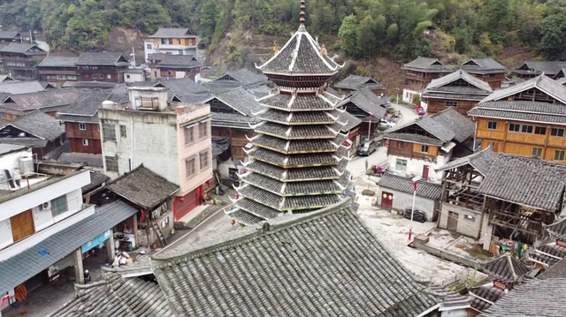 | 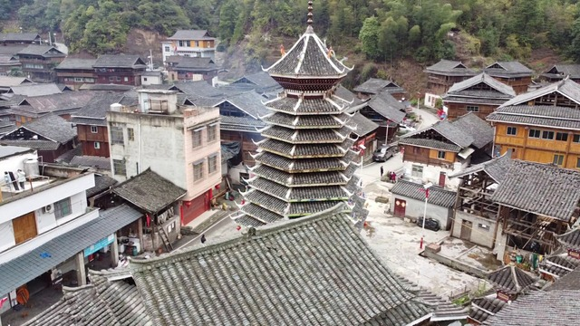 | 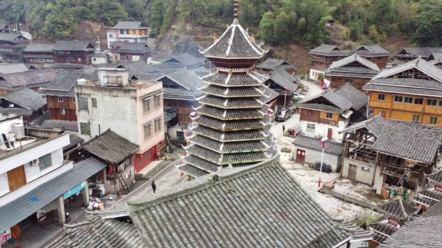 |  |


Renderings are exported from `<OUTPUT_ROOT>/<scene>/<method>/test/ours_*/renders/`. Full quantitative comparisons for all four scenes and both corpora are tabulated in [Main Results](#main-results-uav-aerial-corpus) and [Ground-level quantitative results](#ground-level-quantitative-results) above; the four-method averages are PSNR 31.79 dB (aerial) and 23.44 dB (ground-level) for 3DGS.


## Data Availability


The UAV image corpus, COLMAP sparse reconstructions, and train/test splits are archived on Zenodo (see [Citation](#citation)). Download and extract into `data/` following the structure above. Large binaries (raw images, checkpoints) are excluded from git via `.gitignore`.


## Related Repositories


| Resource | Description |

|----------|-------------|

| [3DGS-Survey](https://github.com/autumn119/3DGS-Survey) | Project page (GitHub Pages) |

| [Zenodo archive](https://doi.org/10.5281/zenodo.21429615) | UAV image corpus & COLMAP reconstructions (permanent DOI) |


## Citation


If you use this work, please cite:


```bibtex
@misc{tao2026_dong_drum_tower,
  author = {Tao, JiaXing},
  title  = {UAV-Based Neural Reconstruction of Dong Drum Towers: A Multi-Case Benchmark for Conservation-Oriented Method Selection},
  year   = {2026},
  note   = {Manuscript under review}
}

```


The archived dataset can be cited as:


```bibtex
@dataset{tao2026_dong_drum_tower_dataset,

  author    = {Tao, JiaXing},

  title     = {UAV-DDT-HeritageBench: Multi-Case UAV Dataset of Dong Drum Towers},

  year      = {2026},

  publisher = {Zenodo},

  doi       = {10.5281/zenodo.21429615},

  url       = {https://doi.org/10.5281/zenodo.21429615}

}

```


## License


This work is licensed under **CC-BY-4.0**. See [LICENSE](LICENSE) for details.

